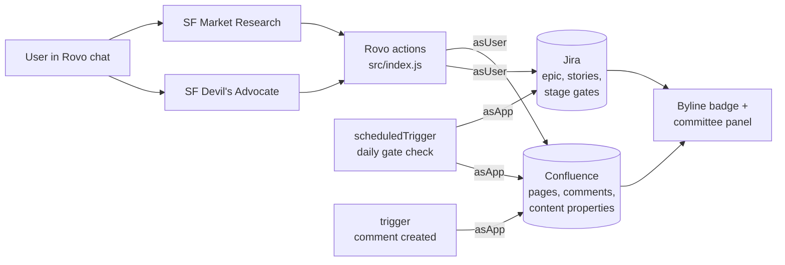

# Architecture

SprintFounders is a Forge app with no external backend. Rovo agents do the reasoning; Forge functions read and
write Confluence and Jira; everything the app remembers is stored in the customer's own site.

## Flow of a review

1. `get-proposal` reads the page as plain text (capped at 12k characters).
2. `find-related-initiatives` runs a relevance-ranked CQL search and a JQL search, including each work item's
   parent epic and description, so a finished story under a cancelled epic is read as a lesson, not reusable work.
3. `get-review-context` gives Devil's Advocate the proposal, the Market Research report and the page comments.
4. `save-report` writes the review as a child page and, for a verdict, stores a structured record on the
   proposal as the content property `sprintfounders-verdict`: verdict, score, axis scores, objection rulings and
   stage gates. The byline reads its title from a second property, so the badge needs no function call.
5. `create-jira-epic` creates the epic and stories after the user confirms, then the stage gates as work items
   with due dates and the labels `sprintfounders-gate` and `sprintfounders-page-<id>`.

## Watching after the verdict

- **Daily gate check** (`src/gateCheck.js`): a JQL query finds gate items past their due date and not done. Each
  one gets a comment in Jira, a footer comment on the proposal and the label `sprintfounders-gate-missed`.
- **New comments** (`src/commentEvents.js`): a comment created after the review increments a counter in the
  verdict record; the badge shows `· N new` until the review is re-run. Comments made by the app are ignored.

## Limits handled

- UI resolvers time out after 25 seconds, so the sample company is created in steps driven by the frontend,
  each one safe to repeat.
- Everything sent by the agents is parsed defensively (`src/lib/verdict.js`): unknown rulings become "noted",
  scores are clamped, and a review without a verdict stores nothing.
- API errors are turned into plain messages for the user (`src/lib/errors.js`).
